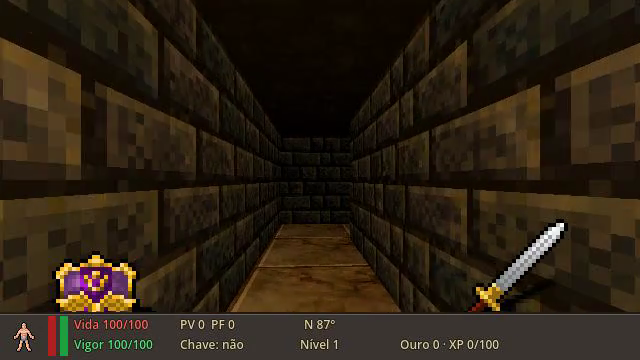
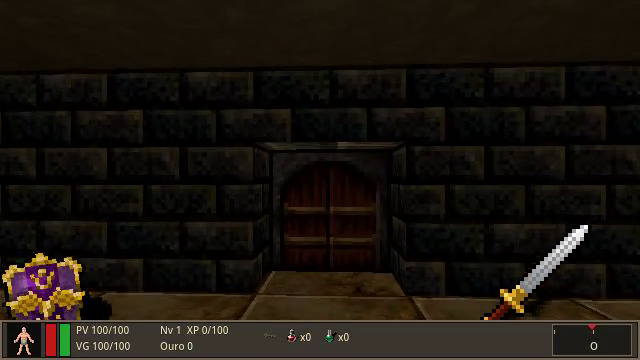
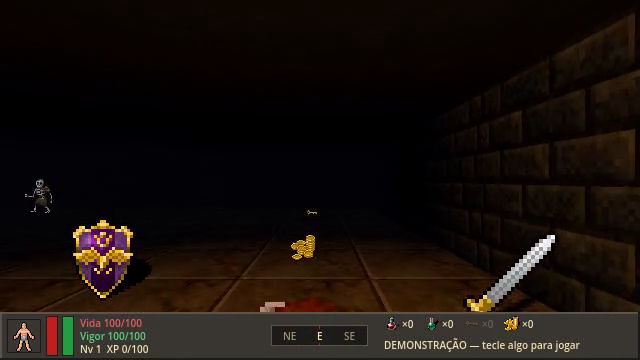
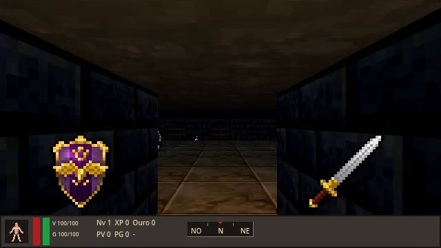
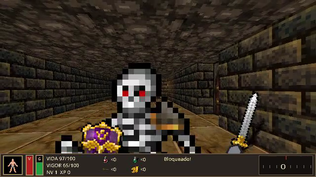
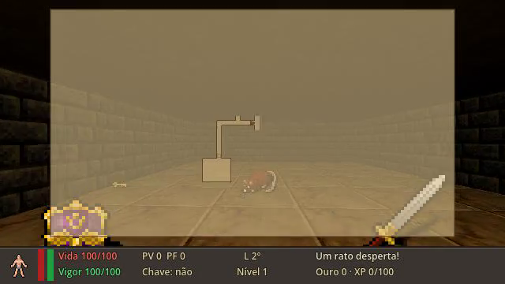

<div align="center">

# ⚔️ Masmorra de Ferro

**ARPG roguelike 3D em primeira pessoa, feito em Godot 4, gerado por agentes de IA com desenvolvimento orientado a hipóteses (HoH)**

*Artefatos experimentais do TCC · IFPE*




</div>

---

## Sumário

- [Sobre o projeto](#sobre-o-projeto)
- [As cinco execuções](#as-cinco-execuções)
- [Galeria de gameplay](#galeria-de-gameplay)
- [Requisitos](#requisitos)
- [Execução rápida](#execução-rápida)
- [Controles](#controles)
- [Exportando binários standalone](#exportando-binários-standalone)
- [Verificação headless (gates)](#verificação-headless-gates)
- [Como replicar o experimento e criar novas iterações](#como-replicar-o-experimento-e-criar-novas-iterações)
- [Estrutura do repositório](#estrutura-do-repositório)
- [Créditos e licença dos assets](#créditos-e-licença-dos-assets)

---

## Sobre o projeto

A **Masmorra de Ferro** é o objeto de benchmark do TCC: um *action RPG* roguelike em primeira pessoa que mistura a movimentação de **DOOM (1993)** (momento, *strafe*, giro só horizontal, inimigos em *billboard* 2.5D, simulação em *ticks* fixos e ponto fixo) com a ambientação de **Daggerfall (1996)** (masmorra medieval, Guerreiro com Vida e Vigor, HUD inferior com barras verticais e bússola, automapa translúcido).

O jogo **não foi escrito à mão**. Cada execução partiu do mesmo repositório-semente (projeto Godot vazio + assets livres) e do mesmo *Game Design Document* congelado ([`GDD.md`](execucoes/exec_1_C2/GDD.md)), e foi construída por agentes de IA ao longo de iterações sob a condição **C2 — HoH completo**:

| Papel | Responsabilidade |
|---|---|
| **Planejador** | escolhe até 2 marcos por iteração e declara o *Preservation Gate* ([`plano_iteracao.md`](execucoes/exec_1_C2/plano_iteracao.md)) |
| **Desenvolvedor** | implementa o núcleo determinístico (`game/sim/`) e a camada de apresentação (`game/view/`) |
| **Verificador** | roda os gates headless, captura quadros/vídeo e devolve evidência estruturada de acertos e lacunas ([`relatorio_provas.json`](execucoes/exec_1_C2/relatorio_provas.json)) |

Os seis marcos incrementais do GDD:

| Marco | Conteúdo |
|---|---|
| **M1** | Controlador em primeira pessoa estilo DOOM, determinístico, com colisão AABB e tabela trigonométrica |
| **M2** | Gerador de masmorra por semente: 6–9 salas conectadas, portas, saída a ≥ 20 células |
| **M3** | Combate do Guerreiro: espada, bloqueio com escudo, Vigor |
| **M4** | Inimigos em *billboard* 2.5D com máquina de estados e campo de fluxo BFS |
| **M5** | Automapa translúcido (Tab) que não pausa o jogo |
| **M6** | Itens, poções, chave, XP e níveis; condição terminal (fuga, morte, tempo esgotado) |

Toda a lógica de jogo vive num núcleo de simulação em aritmética inteira (`game/sim/`, só `RefCounted`), o que torna cada partida **reprodutível por semente** e verificável sem GPU: o *hash* do estado no núcleo e na cena precisa coincidir tick a tick.

---

## As cinco execuções

Todas as cinco execuções C2 concluíram os marcos **M1–M6** com 100 % dos gates passando na última iteração.

| Execução | Iterações | Gates (última iteração) | Status | Destaques | Gameplay |
|:---:|:---:|:---:|:---:|---|:---:|
| [**exec_1_C2**](execucoes/exec_1_C2) | 3 | 43 / 43 ✅ | ✅ Entregue | HUD estilo Daggerfall com retrato e bússola; modo vitrine com piloto automático; espada e escudo em primeira pessoa | [▶ vídeo](execucoes/exec_1_C2/media/gameplay_final_1.mp4) |
| [**exec_2_C2**](execucoes/exec_2_C2) | 3 | 60 / 60 ✅ | ✅ Entregue | Modo atração em arena; `--play`/`--seed=N`; chave e porta trancada; piloto escapa em 50/50 sementes | [▶ vídeo](execucoes/exec_2_C2/media/gameplay_final_2.mp4) |
| [**exec_3_C2**](execucoes/exec_3_C2) | 6 | 83 / 83 ✅ | ✅ Entregue | Trajetória mais longa (M3–M6 só fecharam na 4ª iteração); efeitos sonoros procedurais; modo atração abre o automapa | [▶ vídeo](execucoes/exec_3_C2/media/gameplay_final_3.mp4) |
| [**exec_4_C2**](execucoes/exec_4_C2) | 5 | 75 / 75 ✅ | ✅ Entregue | 13 portas e portal de fuga; 10 sons; telas finais ESCAPOU / MORREU / TEMPO; demo com automapa sépia | [▶ vídeo](execucoes/exec_4_C2/media/gameplay_final_4.mp4) |
| [**exec_5_C2**](execucoes/exec_5_C2) | 5 | 89 / 89 ✅ | ✅ Entregue | Maior suíte de gates; poções de Vida/Vigor, TIMEOUT no tick 18000; `--manual` e `--pilot` | [▶ vídeo](execucoes/exec_5_C2/media/gameplay_final_5.mp4) |

Cada execução também guarda a evidência por iteração em `media/iter_N/` (vídeo curto, dois quadros e `resumo_midia.json`), útil para acompanhar como o jogo evoluiu de uma rodada para a outra.

---

## Galeria de gameplay

<table>
<tr>
<td align="center"><br><b>Execução 1</b> · <a href="execucoes/exec_1_C2/media/gameplay_final_1.mp4">vídeo</a></td>
<td align="center"><br><b>Execução 2</b> · <a href="execucoes/exec_2_C2/media/gameplay_final_2.mp4">vídeo</a></td>
</tr>
<tr>
<td align="center"><br><b>Execução 3</b> · <a href="execucoes/exec_3_C2/media/gameplay_final_3.mp4">vídeo</a></td>
<td align="center"><br><b>Execução 4</b> · <a href="execucoes/exec_4_C2/media/gameplay_final_4.mp4">vídeo</a></td>
</tr>
<tr>
<td align="center" colspan="2"><br><b>Execução 5</b> · <a href="execucoes/exec_5_C2/media/gameplay_final_5.mp4">vídeo</a></td>
</tr>
</table>

> Os vídeos `.mp4` (~10 s cada) são servidos pelo GitHub; clique no link e use *View raw* para baixar ou assistir no navegador.

---

## Requisitos

| Item | Versão / observação |
|---|---|
| **Godot Engine** | **4.7 ou superior** (os projetos declaram `config/features = "4.7"`; testado com 4.7.2.stable). Versão padrão (GDScript), não a .NET |
| **Sistema** | Linux x86_64, com X11 ou Wayland (via XWayland) |
| **Vídeo** | GPU com Vulkan ou OpenGL 3.3 |
| **Bash** | 4+ (para `run.sh`, `export.sh` e `iterate.sh`) |
| **Exportação** | Export templates do Godot da mesma versão do editor (veja abaixo) |
| Opcional | `xvfb-run` para rodar sem monitor; `python3` para as ferramentas em `tools/` |

Instalação do Godot no Linux:

```bash
# Arch
sudo pacman -S godot
# Flatpak (qualquer distro)
flatpak install flathub org.godotengine.Godot
# Ou baixe o binário em https://godotengine.org/download/linux e coloque-o no PATH como "godot"
```

Se o binário tiver outro nome ou caminho, aponte para ele com `GODOT=/caminho/do/godot ./run.sh 1`.
Com Flatpak, crie um *wrapper* no PATH, já que `GODOT` precisa ser um único executável:

```bash
printf '#!/bin/sh\nexec flatpak run org.godotengine.Godot "$@"\n' > ~/.local/bin/godot && chmod +x ~/.local/bin/godot
```

---

## Execução rápida

```bash
git clone git@github.com:IvelOt/masmorra-de-ferro.git
cd masmorra-de-ferro

./run.sh          # menu interativo: escolha de 1 a 5
./run.sh 1        # roda direto a execução 1
./run.sh 5        # ...ou a 5
```

Na primeira vez, o script importa o projeto (`godot --headless --import`) para gerar o cache `game/.godot/`; sem ele, os scripts com `class_name` global não compilam. Depois, abre a cena principal `res://view/main.tscn`.

> 🎮 Ao abrir, o jogo entra em **modo demonstração**: o piloto automático joga sozinho. **Aperte qualquer tecla** para assumir o controle.

Todas as opções do `run.sh`:

| Comando | O que faz |
|---|---|
| `./run.sh` | menu interativo |
| `./run.sh <N>` | joga a execução N (1–5) |
| `./run.sh <N> --editor` | abre o projeto no editor do Godot |
| `./run.sh <N> --gates` | roda a suíte de gates headless |
| `./run.sh <N> --import` | força reimportar o projeto (regenera `game/.godot/`) |
| `./run.sh <N> -- <args>` | repassa argumentos ao jogo, ex.: `./run.sh 2 -- --seed=7` |
| `./run.sh --list` | lista as execuções |

### Sem os scripts (Godot puro)

```bash
godot --headless --path execucoes/exec_1_C2/game --import   # uma vez
godot --path execucoes/exec_1_C2/game                       # joga
godot -e --path execucoes/exec_1_C2/game                    # abre no editor
```

No editor, aperte **F5** para rodar a cena principal.

### Argumentos de cada execução

Cada agente expôs opções próprias na cena principal (passe-as depois de `--`):

| Execução | Argumentos aceitos (veja o cabeçalho de `game/view/main.gd`) |
|---|---|
| 1 | sem argumentos: vitrine de 1 s, depois piloto até a primeira tecla |
| 2 | `--play`, `--seed=N`, `--arena`, `--test-room`, `--combat-room`, `--demo` |
| 3 | `--demo` (modo atração forçado) |
| 4 | `--seed=N`, `--test-room`, `--dummy`, `--autoplay=res://…jsonl`, `--no-demo` |
| 5 | `--seed=N`, `--manual`, `--pilot`, `--demo`, `--test-room`, `--show-map` |

---

## Controles

| Ação | Tecla / mouse |
|---|---|
| Avançar / recuar | **W** / **S** |
| *Strafe* esquerda / direita | **A** / **D** |
| Girar | **←** / **→** ou movimento horizontal do mouse |
| Atacar com a espada | botão esquerdo / **Ctrl** |
| Bloquear com o escudo | botão direito / **Shift** |
| Usar (portas, portal, itens) | **E** / **Espaço** |
| Beber poção de Vida / Vigor | **1** / **2** |
| Automapa (não pausa) | **Tab** |

**Objetivo:** achar a Chave da Saída e alcançar o Portal de Fuga sem morrer. A morte é permanente.

---

## Exportando binários standalone

Cada `game/` já traz um `export_presets.cfg` com o preset **`Linux`** (x86_64, PCK embutido: o resultado é **um único executável**).

### 1. Instale os export templates (uma vez)

Os templates precisam ser da **mesma versão** do editor (ex.: 4.7.2.stable).

```bash
./export.sh --install-templates
```

Isso baixa `Godot_v<versão>_export_templates.tpz` do GitHub oficial do Godot (~1 GB) e extrai em `~/.local/share/godot/export_templates/<versão>/`.
Alternativa pelo editor: **Editor → Gerenciar Templates de Exportação → Baixar e Instalar**.

### 2. Exporte

```bash
./export.sh 1             # exporta a execução 1 (release)
./export.sh all           # exporta as cinco
./export.sh 3 --debug     # build debug (mensagens de erro e asserts)
./export.sh all --out ~/jogos   # outro diretório de saída
```

Saída:

```
build/
├── exec_1_C2/
│   ├── masmorra-de-ferro-exec1.x86_64   ← executável standalone
│   └── export.log
├── exec_2_C2/ …
```

### 3. Rode o binário

```bash
./build/exec_1_C2/masmorra-de-ferro-exec1.x86_64
```

O executável não precisa do Godot instalado e pode ser copiado para outra máquina Linux x86_64. Para distribuir, compacte: `tar czf masmorra-exec1.tar.gz -C build/exec_1_C2 masmorra-de-ferro-exec1.x86_64`.

### Exportação manual

```bash
cd execucoes/exec_1_C2/game
godot --headless --import
godot --headless --export-release "Linux" ../../../build/exec_1_C2/masmorra-de-ferro-exec1.x86_64
```

Para outras plataformas (Windows, macOS), adicione um preset em **Projeto → Exportar…** no editor e use o nome dele no lugar de `"Linux"`.

---

## Verificação headless (gates)

Os gates são as provas mecânicas que o Verificador rodou em cada iteração. Para reproduzi-los:

```bash
./run.sh 5 --gates
# equivalente a:
godot --headless --path execucoes/exec_5_C2/game -s res://tests/run_gates.gd
```

O comando termina com código 0 quando todos os gates passam. O núcleo determinístico também tem um *lint* estático:

```bash
python3 execucoes/exec_1_C2/tools/lint_sim.py
```

Sem monitor, quadros reais da cena podem ser gravados com:

```bash
xvfb-run -a godot --path execucoes/exec_1_C2/game --write-movie /tmp/f.png --fixed-fps 60 --quit-after 600
```

---

## Como replicar o experimento e criar novas iterações

As cinco execuções acima são artefatos congelados. Para rodar o experimento de novo, ou testar outro modelo, outro prompt ou outra versão do Godot, o repositório traz o ponto de partida e o ciclo completo:

| Peça | Onde | O que é |
|---|---|---|
| Repositório-semente | [`template/`](template) | `GDD.md` oficial com os marcos M1–M6, `game/project.godot` inicial, assets CC0 (`game/assets/free/`, `asset_map.json`, `CREDITS.md`), `export_presets.cfg`, esqueleto vazio de `game/tests/run_gates.gd` e `tools/` (`gen_trig_table.py`, `lint_sim.py`). **Nenhum código de jogo.** |
| Prompts e papéis | [`experiment/prompts/`](experiment/prompts) | Planejador, Desenvolvedor e Testador / Auditor Multimodal, com o texto exato usado no TCC |
| Evidência | [`experiment/schemas/`](experiment/schemas) | JSON Schema do `relatorio_provas.json` |
| Orquestração | [`iterate.sh`](iterate.sh) | cria execuções, mostra ou roda cada fase, captura mídia, roda gates e checagens |

O protocolo (papéis, diagrama do ciclo, formato da evidência e diferenças em relação ao orquestrador original) está em [`experiment/README.md`](experiment/README.md).

### O ciclo HoH em três papéis

Cada rodada `N` passa por quatro fases, e cada uma termina com um commit de mensagem fixa no repositório git da execução:

1. **Planejador** lê o `GDD.md` e a evidência da rodada anterior, escolhe até 2 marcos e escreve `plano_iteracao.md` → `docs: plano iteracao N`.
2. **Desenvolvedor** implementa o plano em `game/` (núcleo inteiro em `sim/`, cena `view/main.tscn`, gates em `tests/run_gates.gd`) → `feat: implementacao iteracao N`.
3. **Captura** (feita pelo `iterate.sh`, sem agente): `--check-only` e 6 s de vídeo da cena com dois quadros em `media/iter_N/` → `chore: midia capturada para auditoria da iteracao N`.
4. **Testador / Auditor Multimodal** olha os quadros, roda os gates headless e escreve `relatorio_provas.json` → `docs: provas iteracao N`.

A execução termina quando o Testador grava `"all_milestones_passed": true`. No TCC o limite foi de 6 rodadas.

### Fluxo dos assets

Os sprites e texturas são dados fixos: vêm prontos em `template/game/assets/free/` (Dungeon Crawl Stone Soup, CC0), com um identificador lógico por arquivo em `asset_map.json` e origem e SHA-256 em `CREDITS.md`. Os agentes só os referenciam (`res://assets/free/...` ou pelo identificador do mapa) e não criam arte nova. `./iterate.sh check` confere que todo PNG tem entrada em `CREDITS.md` e que nada de `game/assets/daggerfall/` foi versionado.

### Passo a passo

```bash
# 1. Crie uma execução a partir do template (vira um repositório git próprio)
./iterate.sh new exec_custom          # -> execucoes/exec_custom/

# 2. Veja a próxima fase: imprime o prompt pronto do Planejador da rodada 1
./iterate.sh next exec_custom

# 3a. Manual: abra o Claude Code (ou outro agente) dentro da execução e cole o prompt
cd execucoes/exec_custom && claude --model opus

# 3b. Ou deixe o script chamar o agente na fase pendente
./iterate.sh next exec_custom --run

# 4. Repita "next" até o fim, ou rode o ciclo inteiro sozinho (até o aceite ou 6 rodadas)
./iterate.sh loop exec_custom --max 6

# Acompanhe
./iterate.sh status exec_custom       # fases concluídas por rodada e próxima fase
./iterate.sh list                     # todas as execuções
```

Sem argumentos, `./iterate.sh` abre um menu interativo. Todos os comandos:

| Comando | O que faz |
|---|---|
| `new <nome>` | copia `template/` para `execucoes/<nome>/`, faz `git init` e o commit inicial |
| `list` / `status <nome>` | lista as execuções / mostra as fases de cada rodada e a próxima |
| `next <nome> [--run]` | mostra o prompt da próxima fase (ou a executa com `--run`; a captura sempre executa) |
| `plan` / `dev` / `test <nome> [--iter N] [--run]` | uma fase específica do Planejador, Desenvolvedor ou Testador |
| `prompt <nome> <plan\|dev\|test> [--iter N]` | só o texto do prompt, para colar ou redirecionar (`\| claude -p`) |
| `capture <nome> [--iter N]` | grava `media/iter_N/` (vídeo, `frame_1.png`, `frame_2.png`, `resumo_midia.json`) |
| `loop <nome> [--max N]` | roda plan → dev → capture → test com o agente até o aceite ou N rodadas |
| `gates <nome>` | `godot --headless --path game -s res://tests/run_gates.gd` (exit 0 = todos passam) |
| `check <nome>` | sintaxe de cada `.gd` (`--check-only`), `tools/lint_sim.py` e guarda de assets |
| `validate <nome>` | valida `relatorio_provas.json` contra o esquema |
| `play` / `editor <nome>` | joga a cena principal / abre no editor |

`gates`, `check`, `validate` e `status` também funcionam nas execuções arquivadas (ex.: `./iterate.sh gates exec_1_C2`); os comandos que escrevem recusam essas cinco.

Configuração por variáveis de ambiente:

| Variável | Padrão | Uso |
|---|---|---|
| `HOH_AGENT_CMD` | `claude -p --model "$HOH_MODEL" --dangerously-skip-permissions` | agente chamado com `--run`; recebe o prompt na entrada padrão, roda dentro da execução e vê `HOH_ROLE`, `HOH_ITER` e `HOH_MODEL` |
| `HOH_MODEL_PLANNER` / `HOH_MODEL_DEVELOPER` / `HOH_MODEL_TESTER` | `opus` / `opus` / `sonnet` | modelos de cada papel (os do TCC) |
| `RUNS_DIR` | `./execucoes` | onde as execuções são criadas |
| `CAPTURE_SECONDS` | `6` | duração da gravação de cada rodada |
| `GODOT` | `godot` no PATH | binário do Godot 4.7+ |

> ⚠️ O padrão de `--run` dá ao agente permissão total dentro da execução (como no TCC, onde cada papel rodava isolado). Use num ambiente descartável, ou troque o comando em `HOH_AGENT_CMD`.

A captura precisa de `xvfb-run` (ou de um display) e de `ffmpeg` para o vídeo; sem `ffmpeg`, só os quadros são salvos. As execuções novas ficam fora do git deste repositório (`.gitignore`), cada uma com o próprio histórico de commits por fase.

---

## Estrutura do repositório

```
masmorra-de-ferro/
├── run.sh                    # roda / abre no editor / testa uma execução
├── export.sh                 # gera binários standalone Linux x86_64
├── iterate.sh                # cria e conduz execuções novas do ciclo HoH
├── scripts/common.sh         # funções compartilhadas pelos scripts
├── template/                 # repositório-semente limpo: GDD, project.godot, assets CC0, tools
├── experiment/               # prompts dos papéis, esquema e validador de relatorio_provas.json
└── execucoes/
    └── exec_N_C2/            # N = 1..5, mesma estrutura em todas
        ├── GDD.md            # Game Design Document congelado (igual nas cinco)
        ├── plano_iteracao.md # planos do agente Planejador, iteração a iteração
        ├── relatorio_provas.json  # evidência do Verificador (verified / gap)
        ├── tools/            # lint do núcleo, gerador da tabela trigonométrica
        ├── media/
        │   ├── gameplay_final_N.mp4   # vídeo final de gameplay
        │   ├── screenshot_N_*.png     # capturas demonstrativas
        │   └── iter_K/                # vídeo, quadros e resumo de cada iteração
        └── game/             # projeto Godot 4
            ├── project.godot
            ├── export_presets.cfg
            ├── sim/          # núcleo determinístico (inteiros, sem física)
            ├── view/         # apresentação 3D; main.tscn é a cena principal
            ├── input/        # amostragem de teclado/mouse → input inteiro
            ├── scripts/      # runner headless
            ├── tests/        # gates e trilhas de replay (.jsonl)
            └── assets/       # texturas CC0 + asset_map.json
```

O que foi deixado de fora da cópia original: o histórico `.git` de cada execução, o cache `game/.godot/` (regenerado na importação) e as capturas brutas `.avi` (os mesmos vídeos estão em `.mp4`).

---

## Créditos e licença dos assets

Todas as texturas e sprites em `game/assets/free/` vêm do pacote **Dungeon Crawl Stone Soup Full** (tiles 32×32) do [OpenGameArt](https://opengameart.org/content/dungeon-crawl-32x32-tiles), sob **CC0 1.0** (domínio público). A lista arquivo a arquivo, com origem e SHA-256, está em `game/assets/CREDITS.md` de cada execução.

Nenhum asset de Daggerfall é distribuído: o perfil de arte `daggerfall` previsto no GDD nunca entrou no repositório-semente e está no `.gitignore`.

<div align="center">
<sub>Trabalho de Conclusão de Curso · IFPE · 2026</sub>
</div>
